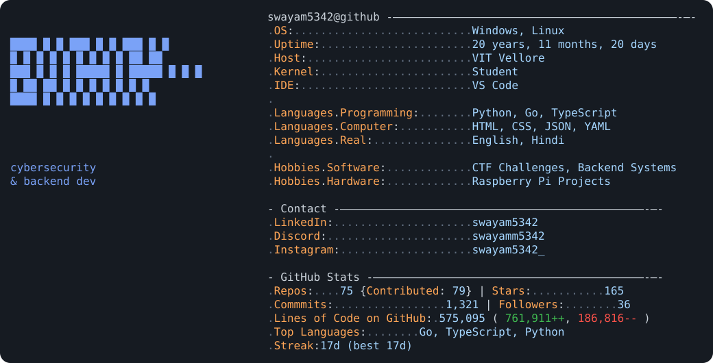

# 👨‍💻 About Me
<picture>
  <source media="(prefers-color-scheme: dark)" srcset="./dark_mode.svg">
  <source media="(prefers-color-scheme: light)" srcset="./light_mode.svg">
  
</picture>

---

# 🚀 Featured Projects

- **[PlugIt](https://github.com/swayam5342/plugit)** (Go): turns any REST API (OpenAPI, Swagger, Postman) into a curated, safe MCP server for Claude, Codex, Cursor and VS Code. One local binary, no telemetry.
- **[SyscallGuard](https://github.com/swayam5342/SGD)** (C): per-job budgets for expensive Linux system calls, built on seccomp user notification. No kernel module, no root to enforce.
- **[sandboxd](https://github.com/swayam5342/sandboxd)** (Go): compiles and runs untrusted code inside NsJail, as user nobody with no network, behind a JSON API.
- **[crawler](https://github.com/swayam5342/crawler)** (Go + Next.js): a self-hosted crawler that obeys robots.txt, paces each domain, retries with backoff and resumes after a crash.
- **[dnsr](https://github.com/swayam5342/dnsr)** (Go): a DNS resolver written from scratch, with its own wire-format codec, DNSSEC validation and a recursive server over UDP, TCP and DNS over TLS.
- **[Tributary](https://github.com/swayam5342/tributary)** (Go): a self-hosted file manager that joins several Google Drive accounts into one pool.

Smaller builds: a [Thompson NFA regex engine](https://github.com/swayam5342/thompson), a [6502 emulator](https://github.com/swayam5342/6502), a [GNU ls clone](https://github.com/swayam5342/ls) and a [falling-sand sandbox](https://github.com/swayam5342/grain).

---

# 🔐 Interests

Linux internals · networking · web security · reverse engineering · CTFs. Currently learning Rust and offensive security.

---

# 🛠️ Languages & Tools

  

---

# 📊 GitHub Stats

---

# 🌐 Connect With Me

